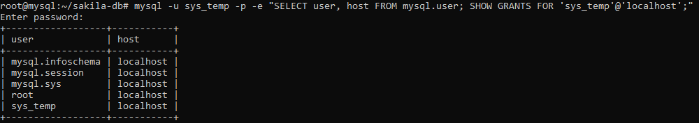
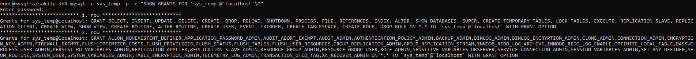
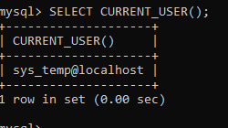
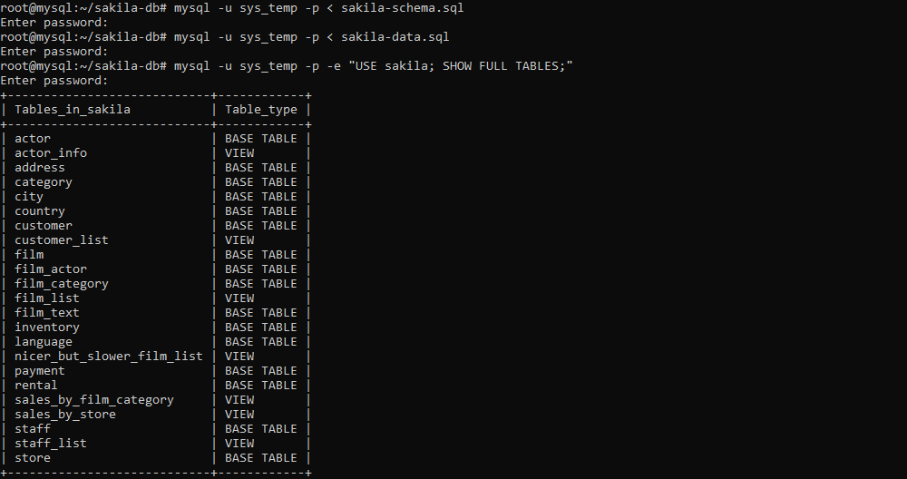
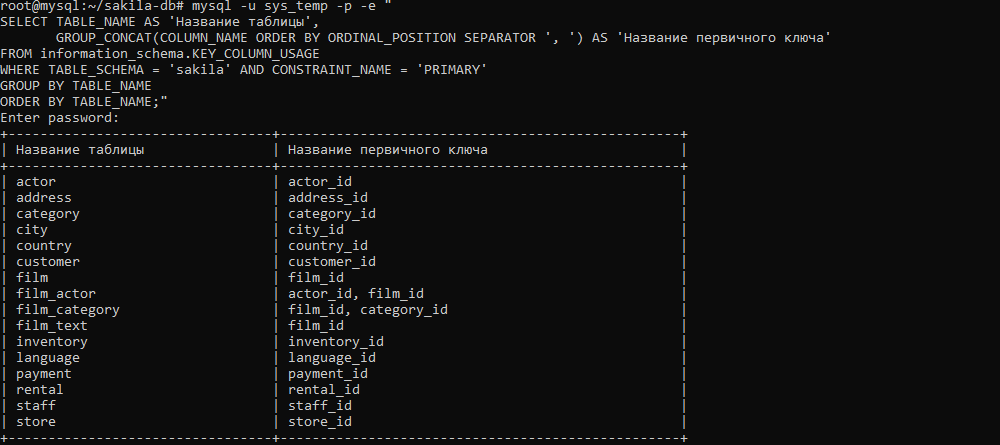

# Домашнее задание к занятию «Работа с данными (DDL/DML)»

**Выполнил:**

---

## Задание 1

### 1.1. Установка MySQL 8.0+

В стандартных репозиториях Debian 12 MySQL нет (только MariaDB), поэтому подключён официальный APT-репозиторий MySQL. ВМ — Yandex Cloud, Debian 12.

```bash
apt update && apt install -y wget gnupg lsb-release unzip
wget https://dev.mysql.com/get/mysql-apt-config_0.8.40-1_all.deb
dpkg -i mysql-apt-config_0.8.40-1_all.deb
apt update
apt install -y mysql-server
systemctl enable --now mysql
```

Установлена версия **MySQL 8.4.13 Community Server**.

### 1.2. Создание учётной записи sys_temp

```sql
CREATE USER 'sys_temp'@'localhost' IDENTIFIED BY 'Passw0rd!';
```


### 1.3. Список пользователей

```sql
SELECT user, host FROM mysql.user;
```



### 1.4. Выдача всех прав пользователю sys_temp

```sql
GRANT ALL PRIVILEGES ON *.* TO 'sys_temp'@'localhost' WITH GRANT OPTION;
FLUSH PRIVILEGES;
```

### 1.5. Список прав пользователя sys_temp

```sql
SHOW GRANTS FOR 'sys_temp'@'localhost'\G
```



### 1.6. Переподключение от имени sys_temp

В MySQL 8.4 плагин `mysql_native_password` по умолчанию отключён, поэтому перед сменой типа аутентификации он был включён в конфигурации:

```bash
echo "mysql_native_password=ON" >> /etc/mysql/mysql.conf.d/mysqld.cnf
systemctl restart mysql
```

```sql
ALTER USER 'sys_temp'@'localhost' IDENTIFIED WITH mysql_native_password BY 'Passw0rd!';
```


```bash
mysql -u sys_temp -p
```

```sql
SELECT CURRENT_USER();
```



### 1.6–1.7. Скачивание и восстановление дампа

```bash
wget https://downloads.mysql.com/docs/sakila-db.zip
unzip sakila-db.zip
cd sakila-db
mysql -u sys_temp -p < sakila-schema.sql
mysql -u sys_temp -p < sakila-data.sql
```

### 1.8. Список таблиц базы данных

```bash
mysql -u sys_temp -p -e "USE sakila; SHOW FULL TABLES;"
```

В базе `sakila` 16 таблиц и 7 представлений.



---

## Задание 2

Таблицы базы `sakila` и их первичные ключи (представления не включены — у них нет первичных ключей):

| Название таблицы | Название первичного ключа |
|---|---|
| actor | actor_id |
| address | address_id |
| category | category_id |
| city | city_id |
| country | country_id |
| customer | customer_id |
| film | film_id |
| film_actor | actor_id, film_id |
| film_category | film_id, category_id |
| film_text | film_id |
| inventory | inventory_id |
| language | language_id |
| payment | payment_id |
| rental | rental_id |
| staff | staff_id |
| store | store_id |

Таблица получена запросом к `information_schema`:

```sql
SELECT TABLE_NAME AS 'Название таблицы',
       GROUP_CONCAT(COLUMN_NAME ORDER BY ORDINAL_POSITION SEPARATOR ', ') AS 'Название первичного ключа'
FROM information_schema.KEY_COLUMN_USAGE
WHERE TABLE_SCHEMA = 'sakila' AND CONSTRAINT_NAME = 'PRIMARY'
GROUP BY TABLE_NAME
ORDER BY TABLE_NAME;
```


